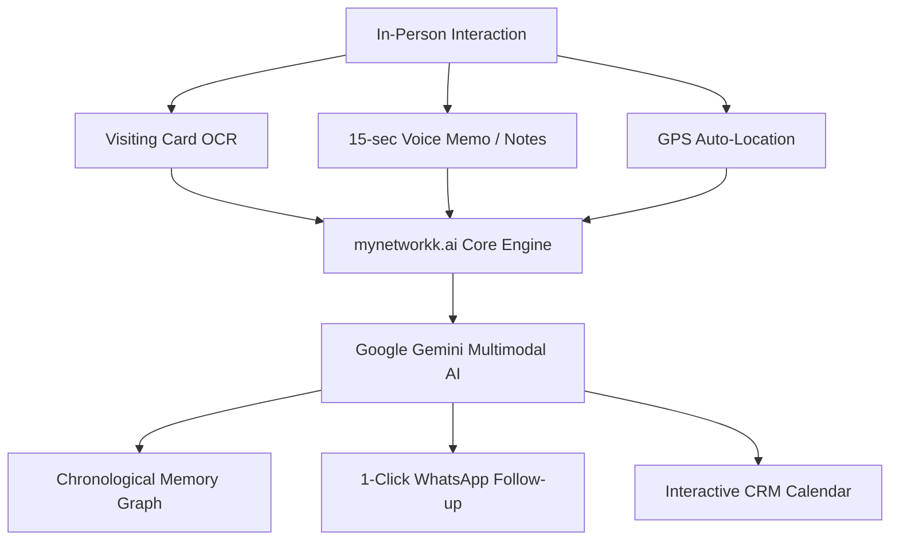

# mynetworkk.ai ✻ — Voice-First Multimodal Relationship Intelligence

[](https://mynetworkkai1.netlify.app/)
[](https://cloud.google.com/)
[](https://ai.google.dev/)
[](https://vitejs.dev/)

> **Team:** `new-era`  
> **Event:** Google DeepMind | Google Cloud Startup Buildathon India 2026  
> **Institution:** Dronacharya College of Engineering & DPG Degree College  
> **Live Web App:** [https://mynetworkkai1.netlify.app/](https://mynetworkkai1.netlify.app/)

---

## 💡 The Problem
In offline networking (tech summits, hackathons, client meetings), founders and professionals meet dozens of valuable connections daily. However, within 48 hours, **severe context decay sets in**:
- Contact numbers and LinkedIn profiles get saved, but the **conversational context is completely lost**—we forget what was discussed, what promises were made, or where we met.
- Traditional CRMs (Salesforce, HubSpot) require tedious manual data entry that attendees and founders abandon.
- **Over 88% of high-potential business relationships die within 14 days** due to broken follow-up loops.

---

## 🚀 The Solution: mynetworkk.ai
**mynetworkk.ai** is a voice-first multimodal AI relationship assistant that bridges the gap between saving contacts and preserving conversational context:

1. **Multimodal Dual-Context Ingestion:**
   - ✍️ **Manual Notes:** Key discussion points, agreements, and next steps.
   - 🎙️ **Enhanced Voice Note Mode:** Web Audio API **2.5x High-Gain Sensitivity Boost** with auto-gain control, noise suppression, and echo cancellation (even whispered / soft speech is captured clearly).
   - ⚡ **Continuous Live Speech-to-Text:** Live transcription directly populates the notes field in real time.
2. **Auto GPS Location Detection:**
   - One-click `📍 Use Current Location` auto-detects meeting venue/address using browser geolocation.
3. **Visiting Card Scanning (OCR):**
   - Instant camera capture and document upload to extract name, company, email, and designation.
4. **Interactive CRM Calendar:**
   - Monthly calendar tracking follow-up tasks, commitments, and deadlines.
5. **AI Memory Assistant & Chronological Timelines:**
   - Ask natural language questions like *"When did I meet Microsoft?"* or search any company/person to receive date-and-time ordered timelines and relationship dossiers.
6. **1-Click WhatsApp Follow-ups:**
   - Context-aware personalized messages pre-drafted and ready to send with one tap before connections go cold.

---

## 🛠️ Architecture & Tech Stack



- **Frontend:** React 18, Tailwind CSS, Lucide Icons, Vite
- **Speech & Audio:** Web Audio API (`AudioContext`, `GainNode` 2.5x boost), Web Speech API (`webkitSpeechRecognition`), MediaRecorder API
- **AI & Cloud Engine:** Google Gemini 2.0 Flash / 1.5 Pro, Google Cloud Run, Firestore, Google Cloud Storage
- **Deployment:** Netlify Global Edge

---

## 🏃 Getting Started Locally

```bash
# 1. Clone the repository
git clone https://github.com/prince-121k/my-network-.git
cd my-network-

# 2. Install dependencies
npm install

# 3. Start development server
npm run dev

# 4. Build for production
npm run build
```

---

## 👥 Team new-era
- **Prince Kumar Pandey** (Founder & Lead Architect)
- **Institution:** Dronacharya College of Engineering & DPG Degree College
- **Contact:** princepandey.contact@gmail.com
- **Live Prototype:** [https://mynetworkkai1.netlify.app/](https://mynetworkkai1.netlify.app/)
